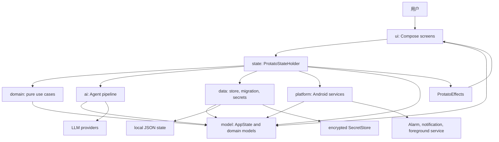
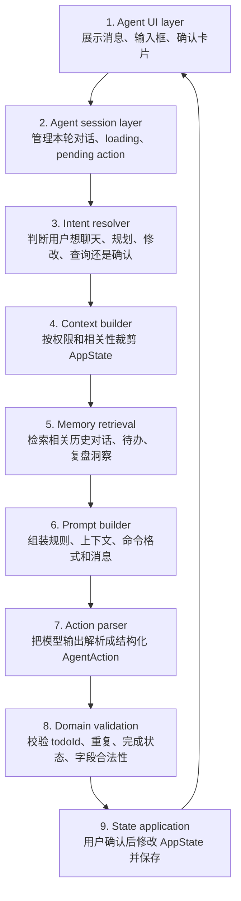
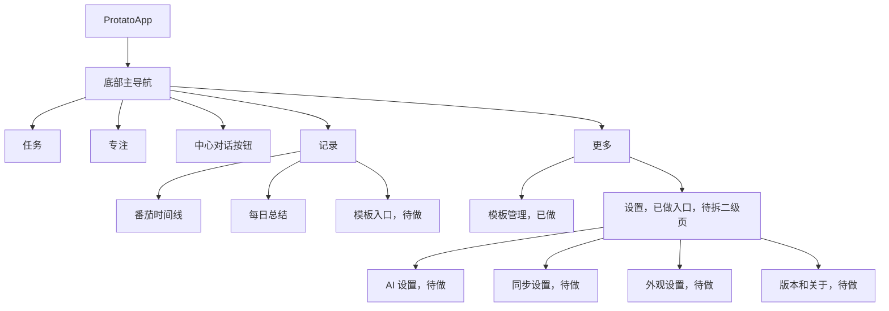

# Protato Refactor Plan

## Purpose

Protato 已经具备待办、番茄计时、复盘记录、AI 对话、模型配置和 WebDAV 同步等完整产品雏形。当前重构的核心目标不是继续堆功能，而是把“大文件 + 弱边界”的结构整理成可持续扩展的架构。

本文件现在只保留三类内容：

- 当前代码已经完成了什么。
- 还有多少没有完成。
- 后续应该按什么边界继续拆。

历史过程中重复的进度日志、过期问题描述和已经完成的阶段说明已合并到末尾的“重复内容整理”。

## Current Snapshot

更新时间：2026-06-12

### Completed

- `MainActivity.kt` 已从约 6999 行降到 35 行，只负责 Activity 启动、通知权限请求和 `setContent { ProtatoApp() }`。
- 原 `ProtatoLogic.kt` 已移除。
- `ui/ProtatoTheme.kt` 已抽出主题。
- `ui/AppNavigation.kt` 已承载主导航枚举和中心突出式底部导航。
- 底部导航已从 6 个一级入口收敛为 5 个主入口：
  - 左侧：`任务`、`专注`
  - 中心：圆形突出的 `对话`
  - 右侧：`记录`、`更多`
- `模板` 和 `设置` 已从底部主导航移入 `更多` 二级入口。
- `ai/LlmClient.kt` 已承载 LLM chat 请求、模型列表请求和基础响应解析。
- 原 `ai/AgentLogic.kt` 已拆分为 `AgentSelectors.kt`、`AgentConversation.kt`、`AgentPromptBuilder.kt`、`AgentContextBuilder.kt`、`AgentActionParser.kt` 和 `LocalAgentFallbacks.kt`。
- 原 `ai/TodoAiLogic.kt` 已拆分为 `TodoSuggestionService.kt`、`TodoPlanParser.kt`、`TodoTextParser.kt`、`TodoDateInference.kt` 和 `TodoMetadataInference.kt`。
- 已引入 `AgentAction` 强类型动作边界，`AgentActionParser` 会把模型输出解析成 `Reply`、`ProposeTodos` 或 `ProposeTodoUpdates`。
- 已增加 `AgentActionParserTest`，覆盖 fenced JSON、native `tool_calls` 和未知工具拒绝。
- 已引入第一版 `AgentIntentResolver`，用确定性规则区分普通聊天、规划待办、修改待办、查询待办、复盘总结、确认/拒绝 pending action 和澄清。
- `AgentContextBuilder` 已按 `AgentDataPermissions` 裁剪待办、番茄记录和模板上下文。
- 已增加 `AgentContextBuilderTest` 和 `AgentIntentResolverTest`。
- 已建立 `ai/AgentTurnService.kt`，统一处理单轮 Agent 请求、本地 fallback、工具解析、重复草案过滤和返回结果。
- 已建立 `ai/AgentSessionState.kt`，集中管理 Agent pending 草案、pending 编辑和 handled key 去重状态。
- `AgentScreen.kt` 不再直接调用 `requestUnifiedAgentChat`、`generateAgentTodoDrafts` 或 `parseAgentToolResponse`，pending action 生命周期也已收敛到 `AgentSessionState`。
- `LlmProviderSettings.isConfiguredForChat()` 已从 UI 辅助文件迁入 `ai/LlmClient.kt`，Provider 可用性判断归 AI/LLM 边界。
- 已建立第一版 `state/ProtatoStateHolder.kt`，集中处理 `AppState` 持有、revision 更新、保存和待办提醒同步。
- 已建立第一版 `state/ProtatoEvents.kt`，并把事件按 `TodoProtatoEvent`、`RecordProtatoEvent`、`TemplateProtatoEvent`、`SettingsProtatoEvent`、`TimerProtatoEvent`、`AgentProtatoEvent` 分成事件族。
- `ProtatoStateHolder.kt` 已收缩为 66 行的状态入口，只负责 dispatch、revision 和保存协调；具体状态变更已拆到各 reducer。
- Todo 新增、批量新增、完成切换、更新、删除和批量删除已通过 `TodoEventReducer` 处理。
- 记录更新和每日总结保存已通过 state event 处理。
- 模板选择、创建/更新和删除已通过 state event 处理，删除最后一个模板时由 state 层兜底默认模板。
- 设置中的昵称、字体、WebDAV、Provider 管理和复盘润色 Provider 选择已通过 state event 处理。
- Focus/timer 的时长修改、session 开始/暂停/清空、pending record 取消和保存已通过 `TimerEventReducer` 处理。
- Agent 对话消息追加、清空对话、确认/拒绝待办草案、确认/拒绝待办编辑草案已通过 `AgentEventReducer` 处理。
- `AgentScreen.kt` 不再接收 `onStateChange(AppState)`，Agent UI 不能直接写整份 `AppState`，只能派发 `ProtatoEvent`。
- 已建立 `state/ProtatoEffects.kt`，state reducer 通过 `ProtatoEffect` 声明提醒取消、提示音、计时服务、计时闹钟和通知取消等副作用。
- 已建立 `platform/ProtatoEffectRunner.kt`，集中执行 Android reminder、timer service、alarm 和 notification 副作用。
- `ProtatoApp.kt` 不再直接调用计时 service、计时 alarm、待办提醒取消或番茄通知取消，只保留页面 glue、WebDAV 同步触发和 Toast。
- 已增加 `ProtatoStateHolderTest`，覆盖 Todo、记录、每日总结、模板、设置、Focus/timer 和 Agent 事件的状态更新、revision 递增和事件结果。
- 已增加 `AgentTurnServiceTest`，覆盖无 Provider 时的本地 Agent turn 和重复待办草案过滤。
- 已增加 `AgentSessionStateTest`，覆盖 pending action 保存、确认/拒绝后的 handled key 记录和 reset。
- `ProtatoStore.kt` 已收缩为 72 行的文件读写外壳，负责本地 JSON 文件读写、调用 codec、返回明确 load result，并在保存/加载时抽取和回填 secrets。
- 已新增 `AppStateJsonCodec.kt`，承载 AppState JSON encode/decode、旧字段兼容和默认值兜底。
- 已增加 `AppStateJsonCodecTest`，覆盖非空 AppState round-trip 和最小 JSON 默认结构。
- 已新增 `ProtatoStoreLoadResult`，读取状态可区分 `Missing`、`Success`、`Recovered` 和 `Failed`。
- 已新增 `AppStateMigration.kt`，第一版集中识别 legacy `llmImport`、`encouragerAgent` 和 `shortBreakMinutes` 兼容恢复。
- 已增加 `ProtatoStoreTest`，覆盖缺失文件、正常读取、legacy 恢复、非法 JSON 失败兜底、主状态 JSON 脱敏、secret 文件回填和旧明文 JSON 在下一次保存时迁出。
- 已配置 `backup_rules.xml` 和 `data_extraction_rules.xml`，从 Android cloud backup 和 device transfer 中排除 `protato-state.json`。
- 已增加 `BackupRulesTest`，防止备份规则遗漏本地状态文件。
- 已新增 `SecretStore.kt` 第一版，将 LLM provider API key 和 WebDAV token 从 `protato-state.json` 分离到 `protato-secrets.json`。
- `ProtatoStore.save()` 已改为保存脱敏后的 AppState JSON，并把 secrets 写入 `SecretStore`；`load()` 会把 secrets 回填到运行时 AppState。
- WebDAV 同步已移动到 `sync/WebDavSync.kt`。
- 日期、ID、标签色等工具已移动到 `util/`。
- Android service / 提示音等平台副作用已移动到 `platform/PlatformEffects.kt`。
- 计时完成、展示记录和计时格式化等逻辑已移动到 `domain/timer/TimerLogic.kt`。
- 已拆出一批 Compose 子组件到 `ui/components/` 和 `ui/screens/...`。
- `TodoFilterControls` 和 `TodoTagFilterDialog` 已从 `TodoScreen.kt` 拆到 `ui/screens/todo/TodoFilterComponents.kt`。
- `Icons.Outlined.Label` deprecation warning 已清理。

### Verified

- 最近一次验证命令：

```bash
JAVA_HOME=/opt/homebrew/opt/openjdk@17/libexec/openjdk.jdk/Contents/Home ./gradlew :app:testDebugUnitTest :app:assembleDebug
```

- 结果：单元测试和 debug 构建通过。

### Current Large Files

这些文件是后续重构的主要目标：

| File | Lines | Status |
| --- | ---: | --- |
| `TodoScreen.kt` | 931 | 仍是最大 UI 文件；筛选区和 TodoRow 已拆出，后续可继续拆编辑区和批量操作 |
| `ui/screens/settings/SettingsCards.kt` | 840 | 设置卡片集合过大，应拆 AI、同步、外观、关于等区域 |
| `AgentScreen.kt` | 495 | Agent UI 仍承担 pending 草案展示和会话 glue，但 LLM turn 流程和 pending lifecycle 已迁入 `ai/` |
| `RecordDialogs.kt` | 577 | 记录弹窗仍偏大，可按保存、编辑、模板回答拆分 |
| `FocusScreen.kt` | 551 | 专注页仍含较多状态和交互逻辑 |
| `ProtatoApp.kt` | 470 | 顶层导航、WebDAV 同步触发和页面 glue 仍偏重，需要继续迁入 `state/` 层 |
| `AppStateJsonCodec.kt` | 446 | JSON encode/decode 已从 store 分离，但仍需要继续拆 legacy adapter 和 secret 引用 |
| `ProtatoStore.kt` | 72 | 已变成文件 I/O shell，并有 load result 和 secret 抽取/回填；后续可把 secret 变换抽到 helper |
| `SecretStore.kt` | 61 | 第一版只做文件分离，后续应接 Android Keystore 或加密实现 |

## Remaining Work

按当前代码状态，主要剩余 6 个重构方向、约 15 个具体任务。

### 1. Agent Command Boundary

状态：基础拆分、`AgentAction`、`AgentIntent` 第一版、权限裁剪、基础测试、Agent state 应用边界、单轮请求服务和 pending action 生命周期已完成；记忆检索仍需继续收紧。

目标：让 Agent 从“prompt 约束的大函数”变成“能提出动作、但不能直接修改状态”的受控管线。

待做：

- 拆分 `ai/AgentLogic.kt`。已完成：
  - `AgentSelectors.kt`
  - `AgentConversation.kt`
  - `AgentPromptBuilder.kt`
  - `AgentContextBuilder.kt`
  - `AgentActionParser.kt`
  - `LocalAgentFallbacks.kt`
- 拆分 `ai/TodoAiLogic.kt`。已完成：
  - `TodoSuggestionService.kt`
  - `TodoPlanParser.kt`
  - `TodoTextParser.kt`
  - `TodoDateInference.kt`
  - `TodoMetadataInference.kt`
- 引入明确的 `AgentAction`，让模型输出只能变成受支持的动作。已完成第一版。
- 补 `AgentActionParserTest`。已完成第一版。
- 引入明确的 `AgentIntent`，先用确定性规则判断用户意图。已完成第一版。
- `AgentContextBuilder` 按权限和相关性裁剪上下文，禁止把完整 `AppState` 直接塞进 prompt。已完成权限裁剪第一版。
- 抽出 `AgentTurnService`，让 Compose 不直接负责 LLM 请求、工具解析和重复草案过滤。已完成第一版。
- 抽出 `AgentSessionState`，让 Compose 不直接维护 pending action 和 handled key 生命周期。已完成第一版。
- `AgentActionParser` 拒绝未知工具、越权动作和不在检索上下文内的 target id。
- domain/state 在用户确认后才应用 mutating action。已完成第一版：Agent 确认新增/编辑待办通过 `AgentProtatoEvent` 和 `AgentEventReducer` 落地。
- 补 `AgentContextBuilderTest`。已完成第一版。

### 2. State Layer

状态：第一版主干和 effects 边界已完成，下一步应收紧异步流程。

目标：让 Compose 页面只发事件，不直接协调大量 `AppState` mutation、存储保存、异步请求和平台副作用。

待做：

- 新建 `state/ProtatoStateHolder.kt`。已完成：持有 `AppState`、统一 revision、保存状态、同步待办提醒。
- 新建 `state/ProtatoEvents.kt`。已完成第一版：Todo、Record、Template、Settings、Timer 事件族已建立。
- 新建事件 reducer。已完成第一版：`TodoEventReducer`、`RecordEventReducer`、`TemplateEventReducer`、`SettingsEventReducer`、`TimerEventReducer`。
- 新建 `AgentEventReducer`。已完成第一版：Agent 消息、确认/拒绝草案和确认/拒绝待办编辑已迁入 state 层。
- 新建 `state/ProtatoEffects.kt`。已完成第一版：`ProtatoEventResult` 返回 `ProtatoEffect` 列表，不再返回一组临时布尔字段。
- 新建 `platform/ProtatoEffectRunner.kt`。已完成第一版：集中执行 Todo reminder、timer service、timer alarm 和 notification 副作用。
- 把 `ProtatoApp.kt` 中的顶层状态变更、保存、同步、计时服务协调迁入 state 层。部分完成：保存、提醒同步、Focus/timer 状态变更和计时平台副作用已迁出；WebDAV 同步请求和 Toast 仍在 `ProtatoApp.kt`。
- 页面通过事件调用 state，而不是直接持有复杂业务流程。部分完成：Todo、记录、每日总结、模板、设置基础操作和 Focus/timer 状态变更已改为派发 `ProtatoEvent`。

### 3. Domain Layer

状态：部分开始，仅 `domain/timer/TimerLogic.kt` 已落地。

目标：业务规则可以不启动 Compose 就测试。

待做：

- 新建 `domain/todo/`，承载 todo 创建、编辑、完成、删除、批量操作、筛选和去重。
- 新建 `domain/record/`，承载记录保存、编辑、每日总结 fallback 和模板字段绑定。
- 新建 `domain/template/`，承载模板创建、编辑、字段校验。
- 继续扩展 `domain/timer/`，把更多计时状态流转从 UI 中移出。
- 补 `TodoParserTest`、`TimerSessionReducerTest`。

### 4. Data and Secrets

状态：已开始。`ProtatoStore.kt` 已从大文件拆成 store 外壳和 `AppStateJsonCodec`，并补了 codec/store 测试；`loadResult()` 第一版已能区分缺失、成功、兼容恢复和失败。Android 备份规则第一版已排除本地状态 JSON 和 secret 文件。SecretStore 文件分离第一版已落地，但尚未加密；用户可见恢复提示和更完整迁移仍未完成。

目标：存储层负责持久化、迁移和密钥安全，不参与业务流程。

待做：

- 将 `ProtatoStore.kt` 拆成 store、JSON adapter、migration、load result。部分完成：store、JSON adapter、migration inspect 和 load result 第一版已拆开。
- 将 `AppStateJsonCodec.kt` 中的旧字段兼容逻辑继续拆到 legacy adapter，避免 codec 继续膨胀。
- `ProtatoStore.load()` 不再长期吞掉所有异常后静默返回空状态，应返回 `Success` / `Recovered` / `Failed`。已完成第一版：兼容保留 `load()`，新增 `loadResult()`。
- API Key 和 WebDAV 应用密码迁入 `SecretStore`。已完成第一版：从 `protato-state.json` 分离到 `protato-secrets.json`，后续需接加密存储。
- AppState JSON 中只保存 secret id 或 alias。部分完成：当前保存时主 JSON 清空敏感值，运行时从 SecretStore 回填；后续模型层可补 alias/id。
- 审查 `android:allowBackup` 和敏感文件备份策略。已完成第一版：`protato-state.json` 和 `protato-secrets.json` 已从 cloud backup 和 device transfer 中排除。
- 补更完整的 `StateMigrationTest`。已完成第一版 `AppStateJsonCodecTest` 和 `ProtatoStoreTest`。

### 5. UI Cleanup

状态：部分完成。

目标：UI 文件继续按页面区域和二级页面拆分，避免形成新的大文件。

待做：

- 拆 `TodoScreen.kt`：
  - screen state / route
  - 日期筛选区。已完成第一版：`TodoFilterComponents.kt`
  - todo list 区。部分完成：`TodoRow` 已迁入 `TodoListComponents.kt`
  - todo editor
  - 批量操作栏
- 拆 `SettingsCards.kt`：
  - AI 设置
  - 同步设置
  - 外观设置
  - 关于/版本
- 将设置页从长表单升级为二级设置中心。
- 为 `RecordsScreen` 增加进入模板管理的自然入口。
- 继续拆 `AgentScreen.kt`、`FocusScreen.kt`、`RecordDialogs.kt` 中的复合 UI。

### 6. Memory Layer

状态：未开始。

目标：让对话、待办、复盘记录和长期记忆通过检索联动，而不是把所有历史文本直接塞进 prompt。

待做：

- 新增 `AgentMemoryItem` 模型。
- 从确认后的 Agent 动作、保存后的总结和用户明确偏好中提取可控记忆。
- 先实现本地确定性检索：
  - 日期匹配
  - 标签匹配
  - todo 标题匹配
  - 复盘标题匹配
  - 最近对话关键词匹配
- 增加记忆查看和删除入口。
- 后续再考虑 embedding，不作为第一阶段目标。

## Target Architecture



核心边界：

- UI 展示状态并发出事件。
- state 协调业务、存储、AI 和平台副作用。
- domain 只处理纯业务规则。
- ai 只能返回结构化动作，不能直接修改状态。
- data 只负责持久化、迁移和密钥。
- platform 只负责 Android 系统能力。

## Target Package Structure

```text
app/src/main/java/com/protato/app/
  MainActivity.kt
  ProtatoApp.kt

  model/
    AppState.kt
    TodoModels.kt
    TimerModels.kt
    RecordModels.kt
    AgentModels.kt
    SyncModels.kt

  state/
    ProtatoStateHolder.kt
    ProtatoEvents.kt
    ProtatoEffects.kt

  data/
    ProtatoStore.kt
    AppStateJson.kt
    StateMigration.kt
    SecretStore.kt

  domain/
    todo/
    timer/
    record/
    template/

  ai/
    LlmClient.kt
    AgentIntentResolver.kt
    AgentContextBuilder.kt
    AgentMemoryStore.kt
    AgentPromptBuilder.kt
    AgentActionParser.kt
    AgentActions.kt
    LocalAgentFallbacks.kt

  ui/
    ProtatoTheme.kt
    AppNavigation.kt
    components/
    screens/

  platform/
    PomodoroTimerService.kt
    PomodoroAlarmScheduler.kt
    PomodoroAlarmReceiver.kt
    PomodoroNotifications.kt
    TodoReminderScheduler.kt
    TodoReminderReceiver.kt
```

## Module Contracts

### model

负责数据结构和枚举。

允许：

- Kotlin data class。
- enum。
- 不含副作用的默认值。

禁止：

- Android `Context`。
- Compose imports。
- 网络请求。
- JSON 解析。
- 业务流程判断。

### ui

负责 Compose 页面、组件和导航。

允许：

- 展示状态。
- 发出用户事件。
- 持有输入框、弹窗开关这类临时 UI 状态。

禁止：

- 直接发 LLM/WebDAV 请求。
- 直接解析工具 JSON。
- 直接构造 prompt。
- 直接安排通知或闹钟。
- 绕过 state 写复杂 `AppState` mutation。

### state

负责应用状态协调。

允许：

- 持有当前 `AppState`。
- 接收 `ProtatoEvent`。
- 调用 `domain/` 计算下一状态。
- 调用 `data/` 保存或加载状态。
- 调用 `ai/` 获取 Agent 回复或动作草案。
- 调用 `platform/` 安排通知、闹钟和服务。

禁止：

- 写大段 prompt。
- 写 JSON 解析细节。
- 把复杂业务规则埋在 UI callback 中。

### domain

负责纯业务规则。

允许：

- Todo 创建、编辑、筛选和去重。
- Timer 状态流转。
- Record 生成和字段绑定。
- 本地解析 fallback。
- 校验和业务不变量。

禁止：

- Android `Context`。
- Compose imports。
- 文件读写。
- 网络请求。
- Toast、Notification、AlarmManager。

### ai

负责 LLM 和 Agent 管线。

允许：

- Provider endpoint 规范化。
- Chat 请求和响应解析。
- Prompt 构造。
- 上下文检索。
- Agent action 解析。
- 本地 fallback 回复。

禁止：

- 直接修改 `AppState`。
- 直接做 UI 确认。
- 忽略 `AgentDataPermissions`。
- 直接读取完整 `AppState` 并塞进 prompt。
- 保存用户数据。

### data

负责本地数据和持久化边界。

允许：

- 读取和写入状态。
- JSON adapter。
- 向后兼容迁移。
- 密钥安全存储。
- Repository 风格接口。

禁止：

- Compose UI。
- Prompt 构造。
- 业务流程决策。
- 直接调用通知、闹钟或 LLM。

### platform

负责 Android 系统能力。

允许：

- `Service`。
- `BroadcastReceiver`。
- `AlarmManager`。
- `NotificationManager`。
- 必须触碰 Android API 的权限检查。

禁止：

- Compose UI。
- LLM 调用。
- Prompt 逻辑。
- 业务推理。

## Dependency Direction

```text
ui -> state -> domain
            -> data
            -> ai
            -> platform

ui -> model
state -> model
domain -> model
data -> model
ai -> model
platform -> model
```

禁止反向依赖：

```text
domain -> ui
model -> data
ai -> ui
platform -> ai
data -> ui
```

## Agent Architecture

Agent 后续不要扩展成一个“会聊天的大函数”。它应该被拆成从 UI 到执行的多层能力，每一层只回答一个问题。



### Where User Meaning Is Determined

“明确知道用户的意思”的层不应该是 UI，也不应该是 prompt，更不应该是工具 JSON parser。

建议由 `AgentIntentResolver` 承担：

```kotlin
class AgentIntentResolver {
    fun resolve(request: AgentIntentRequest): AgentIntentResult
}
```

输入：

```kotlin
data class AgentIntentRequest(
    val userText: String,
    val recentMessages: List<AgentConversationMessage>,
    val pendingActions: List<PendingAgentAction>,
    val contextSummary: AgentContextSummary,
    val nowMillis: Long
)
```

输出：

```kotlin
data class AgentIntentResult(
    val intent: AgentIntent,
    val confidence: Float,
    val reason: String
)
```

第一版用确定性规则即可。低置信度不要猜，应该变成 clarification question。例如用户说“就按第二个来”，但当前没有 pending action，就应该询问用户指的是哪一个，而不是假装知道。

### Agent Pipeline

```text
User message
  -> AgentIntentResolver
  -> AgentContextBuilder
  -> AgentMemoryRetriever
  -> AgentPromptBuilder
  -> LlmClient
  -> AgentActionParser
  -> UI confirmation or plain reply
  -> domain/state apply after confirmation
```

核心原则：

- 模型只能提出动作，不能直接修改状态。
- 权限裁剪发生在 prompt 构造之前。
- domain 校验发生在状态变更之前。
- mutating action 必须经过 UI 确认。

### Intent Types

```kotlin
sealed interface AgentIntent {
    data class Chat(val topic: String?) : AgentIntent
    data class PlanTodos(val rawGoal: String) : AgentIntent
    data class UpdateTodo(val targetHint: String, val changeHint: String) : AgentIntent
    data class QueryTodos(val query: String) : AgentIntent
    data class SuggestNextFocus(val constraint: String?) : AgentIntent
    data class SummarizeRecords(val rangeHint: String?) : AgentIntent
    data class ConfirmPendingAction(val targetHint: String?) : AgentIntent
    data class RejectPendingAction(val targetHint: String?) : AgentIntent
    data class AskClarification(val question: String) : AgentIntent
}
```

### Agent Actions

```kotlin
sealed interface AgentAction {
    data class Reply(val text: String) : AgentAction
    data class ProposeTodos(val todos: List<TodoDraft>) : AgentAction
    data class ProposeTodoUpdates(val edits: List<TodoEditDraft>) : AgentAction
    data class AskClarification(val question: String) : AgentAction
}
```

短期可以继续兼容 fenced JSON，但解析结果必须进入 `AgentAction`，并拒绝未知工具。

## UI Navigation

当前主导航已经完成结构调整：



已完成：

- 主入口不再拥挤。
- 模板和设置已进入 `更多`。
- 对话已成为中心突出入口。

未完成：

- 设置页仍是长表单。
- AI Provider 和 Agent 管理还没有进入单独的 AI 设置页。
- WebDAV 还没有进入单独的同步设置页。
- 外观、版本和关于还没有形成独立二级页面。
- 记录页还没有自然跳转到模板管理。

## Refactor Roadmap

### Phase A: Clean Current Large AI Files

优先级：P0

范围：

- `ai/AgentLogic.kt`。已完成基础职责拆分。
- `ai/TodoAiLogic.kt`。已完成基础职责拆分。

验收：

- prompt、context、parser、fallback 分文件。已完成。
- Todo AI 的服务、计划解析、文本解析、日期推断和元数据推断分文件。已完成。
- Agent action 有明确结构。已完成第一版。
- `AgentActionParserTest` 覆盖工具解析基础路径。已完成第一版。
- `AgentIntentResolver` 有第一版确定性意图层。已完成。
- 权限真正影响上下文。已完成第一版。
- `AgentContextBuilderTest` 覆盖权限裁剪。已完成第一版。
- 编译通过。已完成。

### Phase B: Add State Layer

优先级：P0

范围：

- `ProtatoApp.kt`
- 各 screen 的顶层事件入口。

验收：

- `ProtatoApp.kt` 不再直接承载大量业务协调。部分完成：保存、revision 和提醒同步已迁出。
- UI 通过事件表达用户操作。部分完成：Todo 基础操作、记录更新、每日总结保存、模板管理和设置基础操作已迁出。
- 存储、AI、平台副作用由 state 层统一协调。未完成：计时服务、同步请求和多数页面事件仍在 app shell。

### Phase C: Extract Domain Use Cases

优先级：P1

范围：

- todo
- timer
- record
- template

验收：

- 核心业务规则不依赖 Compose。
- 可补单元测试。

### Phase D: Continue UI Split

优先级：P1

范围：

- `TodoScreen.kt`
- `SettingsCards.kt`
- `AgentScreen.kt`
- `FocusScreen.kt`
- `RecordDialogs.kt`

验收：

- 单个 UI 文件不再承担整页所有区域。部分完成：Todo 筛选区和 TodoRow 已拆出。
- 设置页成为二级设置中心。

### Phase E: Data Safety

优先级：P2

范围：

- `ProtatoStore.kt`
- `SecretStore`
- migration
- backup policy

验收：

- store 不再包含 JSON 编解码细节。已完成第一版：`ProtatoStore.kt` 只保留文件 I/O。
- JSON 编解码有 round-trip 测试。已完成第一版：`AppStateJsonCodecTest`。
- load 有明确结果类型。已完成第一版：`ProtatoStoreLoadResult` 和 `ProtatoStoreTest`。
- 敏感本地状态不进入 Android 备份。已完成第一版：`backup_rules.xml`、`data_extraction_rules.xml` 和 `BackupRulesTest`。
- 主 AppState JSON 不保存明文密钥。已完成第一版：`ProtatoStore.save()` 会脱敏并写入 `SecretStore`。
- SecretStore 仍需加密实现。
- save 失败处理仍需明确。
- 旧数据迁移需继续从 codec 中拆出。

### Phase F: Memory Layer

优先级：P2

范围：

- `AgentMemoryItem`
- memory extraction
- memory retrieval
- memory management UI

验收：

- Agent 能引用相关历史，而不是读取全部历史。
- 用户能查看和删除记忆。

## Feature Readiness

当前已经可以较安全地添加的功能：

- 纯 UI 展示类小功能，例如列表筛选显示、空状态、设置项说明、入口调整。
- 不改变核心状态流的页面整理，例如把设置页继续拆成二级页面。
- 不涉及长期记忆和复杂批量状态变更的轻量交互。
- 小型 AppState 功能可以开始，但必须通过对应事件族、reducer 和 holder 测试接入，避免继续扩大 `ProtatoApp.kt`。
- Todo、Records、Template、Settings 和 Focus/timer 相关小功能可以开始添加，优先通过新增 `ProtatoEvent`、对应 reducer 和 holder 测试落地。
- Agent 提案类功能可以开始小步添加，例如新增一种只生成草案、需要用户确认的建议卡片。
- Agent 单轮回复/草案生成的小功能可以开始添加，但应优先改 `AgentTurnService`、`AgentActionParser` 和 reducer 测试，而不是改 Compose。
- Agent pending action 展示/确认的小功能可以开始添加，但应优先改 `AgentSessionState` 和 `AgentEventReducer`，再薄改 UI。

建议暂缓的新功能：

- Agent 自动落地修改待办、复盘或设置。
- 长期记忆、历史检索、跨对话联动。
- 复杂同步、迁移、密钥安全相关功能。数据层已开始拆分，load result、备份排除和 SecretStore 文件分离已有第一版，但这些能力仍需要加密 SecretStore 和更完整 migration 后再做。
- 大范围状态流功能，例如全局撤销、跨页面任务流、批量自动规划。

推荐门槛：

- 想加普通 UI/体验功能：现在可以开始，但仍要小步做。
- 想加 Agent 提案类功能：现在可以开始，但必须走 `AgentIntent`、`AgentAction`、权限裁剪和用户确认。
- 想加 Agent 记忆类功能：先完成 `AgentMemoryItem`、memory retrieval 和记忆管理入口。
- 想加影响 Todo、Records、DailySummary、Template、基础 Settings 或 Focus/timer 的小功能：现在可以开始，但应补对应事件族 reducer 和 state holder 测试。
- 想加影响 AppState 的跨模块核心功能：先建立对应事件族 reducer、`ProtatoEffect` 或 domain use case，避免把异步副作用继续放大在 `ProtatoApp.kt`。
- 想加数据安全或同步增强：`ProtatoStore.kt` 已完成 store/codec/load result 第一版，备份排除和 SecretStore 文件分离已落地，下一步先接加密 SecretStore 和更完整 migration。

## Testing Strategy

优先补这些测试：

- `AgentActionParserTest`。已完成第一版。
- `AgentContextBuilderTest`
- `ProtatoStateHolderTest`。已覆盖 Todo、记录、每日总结、模板、设置和 Focus/timer 事件。
- `AppStateJsonCodecTest`。已覆盖非空 AppState round-trip 和最小 JSON 默认结构。
- `ProtatoStoreTest`。已覆盖缺失、成功、恢复、失败读取结果、secret 分离保存和旧明文迁出。
- `BackupRulesTest`。已覆盖 Manifest 引用和本地状态文件备份排除规则。
- `TodoParserTest`
- `TimerSessionReducerTest`
- 更完整的 `StateMigrationTest`

手动 QA：

- 启动、暂停、继续、重置计时。
- 完成专注并保存复盘记录。
- 新建、编辑、完成、删除待办。
- 设置提醒并验证闹钟调度。
- 通过 Agent 生成 todo 草案。
- 拒绝和接受 Agent todo 提案。
- 生成每日总结。
- 配置 provider 后不丢失已有 key。
- 使用测试凭据同步 WebDAV。

## Non Goals

第一阶段不做：

- 把 JSON 存储替换成 Room。
- 引入 embedding。
- 重写全部 UI 视觉。
- 支持所有 provider 的原生 tool calling。
- 增加账号体系或远端后端。

## Duplicate Content Cleanup

这次整理合并或删除了以下重复内容：

- `Progress`、`Refactor Phases`、`Definition of Done` 中重复出现的 `MainActivity.kt` 瘦身描述，合并到 `Current Snapshot`。
- `Still Open` 和各 Phase 中重复的待办项，合并到 `Remaining Work`。
- 旧的 `Current Problems -> Oversized Entry File` 已过期，因为 `MainActivity.kt` 已完成拆分；改为用 `Current Large Files` 记录当前真实风险。
- 底部导航的设计、状态和验收描述重复出现多次，合并到 `UI Navigation`。
- Agent 的功能层、pipeline、intent、action 和 memory 描述原本分散且部分重复，合并到 `Agent Architecture`。
- “模块契约”的解释和依赖方向保留，但压缩为每个模块的允许/禁止事项。
- 已完成的历史操作保留结果，不再逐条保留过程日志。

## Definition of Done

重构整体完成时应满足：

- `MainActivity.kt` 只负责 Activity setup。已完成。
- 主导航不再有 6 个底部入口。已完成。
- `ProtatoApp.kt` 不再承担主要业务协调。
- `state/` 层接管事件、保存、AI、同步和平台副作用协调。
- `domain/` 层承载可测试业务规则。
- `ai/` 层完成 prompt、context、intent、action parser 和 memory 的边界拆分。
- Agent context 严格遵守权限和相关性裁剪。
- secrets 不再存储在普通 JSON 中。
- 核心业务逻辑有单元测试。
- 新功能可以落到对应 feature/module，而不是回到大文件堆叠。
